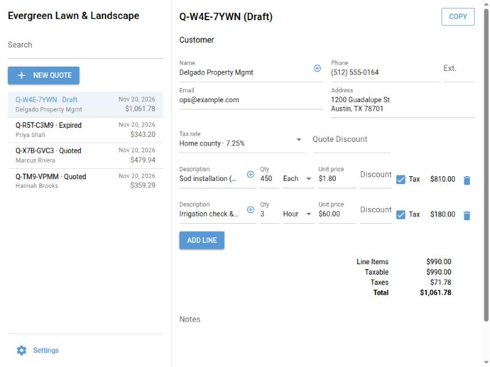

# Quote Builder

A simple desktop app for building price quotes to give to customers.
Created by Brian M. Chandler.



Quote Builder is for micro businesses and solo consultants — odd
software jobs, yard work, house cleaning, and the like. It runs as a
native desktop window on Linux, stores everything locally in a single
SQLite file, and works without an internet connection. One user, one
machine: no accounts, no sign-in, nothing in the cloud.

The business details, customers, and a catalog of reusable services
stay in the app, so a new quote is mostly picking from what's already
there. The math behind a quote's discounts and tax is documented in
[CALCULATIONS.md](CALCULATIONS.md).

## Scope

In scope:

- One or more businesses (a main one and a side activity or two), each
  with its own quotes, customers, catalog, and settings.
- Saved customers, and a catalog of reusable services and parts.
- Quotes made of line items, with per-line or whole-quote discounts and
  tax, and a status up to the point of giving the quote to the customer.
- Printing a quote (it opens as a page in your browser, where
  Print → Save as PDF gives a PDF).

Out of scope: more than one user or syncing between machines, sending
email from the app, and following a quote to its outcome (accepted or
declined). Turning a quote into an invoice, quote templates, and CSV
export may come later.

## Install

Quote Builder is built and tested on Linux only. macOS and Windows
aren't targeted or tested.

The native window is drawn with GTK's WebKitGTK, so a few stock system
packages are needed once, before installing. The package names differ
between the two main Debian and Ubuntu families:

- Debian 13 (and LMDE):

  ```bash
  sudo apt install libgirepository-2.0-dev libcairo2-dev pkgconf python3-dev gir1.2-webkit2-4.1
  ```

- Ubuntu 24.04 or newer (and Linux Mint 22 or newer):

  ```bash
  sudo apt install libgirepository-2.0-dev libcairo2-dev pkg-config python3-dev gir1.2-webkit2-4.1
  ```

  Older Ubuntu (22.04) doesn't carry `libgirepository-2.0-dev` and
  won't work. On other systems, install the equivalents with their own
  package manager.

Quote Builder is installed with [uv](https://docs.astral.sh/uv/), a
tool that installs Python apps like this one. It fetches Python 3.13 and
everything else the app needs by itself, except git, which uv uses to
download the app's code.

1. Install git, if it isn't already. On Debian, Ubuntu, or Mint:

   ```bash
   sudo apt install git
   ```

   On other systems, use their package manager, or see git's
   [download page](https://git-scm.com/downloads).
2. Install uv by following the steps on its
   [installation page](https://docs.astral.sh/uv/getting-started/installation/).
3. Check that it's found. In a terminal, run:

   ```bash
   uv -V
   ```

   It prints uv's version, like `uv 0.12.17`. If it says `uv` isn't
   found instead, close the terminal, open a new one, and try again:
   the installer's changes may only reach terminals opened after it.
4. Then install Quote Builder, and run it:

   ```bash
   uv tool install "git+https://github.com/bmchandler/quote_builder"
   ```

   ```bash
   quote-builder
   ```

To update to a newer release:

```bash
uv tool upgrade quote-builder
```

To uninstall it:

```bash
uv tool uninstall quote-builder
```

Uninstalling removes only the app: your quotes stay in
`~/.local/share/quote-builder/` (see [Your data](#your-data)), and are
there again if you reinstall. To remove them as well, delete that
folder.

## Using it

- **Businesses.** The app opens on the business you used last. Settings
  (in the side panel) is where you add another business or a side
  activity, and set its name, how long a quote stays valid, and its tax
  rates. Each business keeps its own quotes, customers, and catalog;
  nothing is shared between them.
- **Customers and catalog.** Save a customer once and pick them for a
  quote, which takes its own copy of their details. Keep reusable
  services and parts in the catalog and add them to a quote by name.
- **Quotes.** A quote is a list of line items. Each line can carry a
  discount and tax, or the whole quote can take one discount; the foot
  shows the breakdown. A quote starts as a draft, and marking it Quoted
  freezes its figures and the business's details for the printout. A
  later change becomes a new revision (R1, R2), and the list shows only
  the newest version of each quote.
- **Finding a quote.** The list runs down the side, newest first, and
  Search matches a quote's number, notes, any line's description, and
  the customer's name, email, phone, or address.
- **Printing.** A quote opens as a standalone page in your default
  browser, where Print → Save as PDF gives a PDF — no extra software.
- **Save before closing.** Closing the window doesn't yet warn you about
  unsaved changes, so save a quote before you close the app.

## Your data

Your quotes live in one SQLite file, `quotes.db`, in
`~/.local/share/quote-builder/` (or `$XDG_DATA_HOME/quote-builder/`
when that's set). Upgrading the app updates this file to the new
version in place, keeping your quotes; an interrupted upgrade leaves it
as it was. Uninstalling leaves the file too. Back it up to be safe, and
delete the folder to remove your quotes.

## Status

This is an early release (MVP). Built: everything above. Not built yet:
invoices, quote templates, and CSV export.

What changed in each release is in [CHANGELOG.md](CHANGELOG.md).
Licensed under the MIT License ([LICENSE.md](LICENSE.md)).

Found a problem, or have a request? Open an issue on the project's
[issues page](https://github.com/bmchandler/quote_builder/issues).
